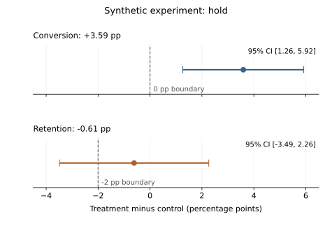

# Product Analytics Experimentation Lab

A reproducible, synthetic product-analytics project using Python, SQLite and
Streamlit. It generates users, sessions, events and experiment assignments, then
builds descriptive metrics and a fixed-horizon A/B-test readout.

**Question:** does a redesigned onboarding experience improve purchase conversion
while keeping retention and revenue losses within declared tolerances?

[Workflow and code map](WORKFLOW.md) · [Generated report](outputs/analysis_report.md) ·
[Full-precision readout](outputs/experiment_readout.json)

## Example result: hold



The saved example includes **4,413 fully observed users** (2,179 control and 2,234
treatment); 587 recent assignments are excluded. Conversion improves, but the
retention interval does not establish noninferiority within the illustrative
2-percentage-point loss tolerance. **This is uncertainty, not proof of harm.**
The revenue, sample-size and assignment-balance gates pass; retention blocks the
overall decision.

These are synthetic results, not measured customer or business benefits.
[Plot source and reproduction](docs/VISUAL_EVIDENCE.md) use the committed
full-precision readout, not rounded values copied from the chart.

## Run locally

Python 3.12 is covered by the repository's CI. From the repository root:

```sh
python -m venv .venv
# Activate .venv for your shell, then:
python -m pip install -r requirements.txt
python scripts/build_dataset.py
python scripts/run_analysis.py
python scripts/run_guardrail_scenarios.py
python -m unittest discover tests -v
streamlit run app.py
```

No external dataset, credentials or API calls are needed. The default generator
uses seed 18018 and creates 5,000 users, 5,000 assignments, 22,287 sessions and
64,908 events. Building replaces the local `data/product_analytics.sqlite`;
analysis and scenario commands rewrite their reports in `outputs/`. The dashboard
also creates the database when absent and has a local rebuild button.

## What the analysis does

- Computes event-stage counts by variant, acquisition-channel summaries and
  signup-cohort retention. Stage counts record event occurrence, **not a strictly
  ordered funnel**.
- Validates assignment/event integrity and keeps inactive eligible users in the
  denominator. Both arms use the same complete eight-day follow-up horizon.
- Checks enrolled and eligible sample ratios with exact binomial tests; estimates
  conversion/retention differences with Newcombe/Wilson intervals and revenue
  differences with a Welch interval.
- Uses one shared decision function for the report and dashboard. Sample size,
  assignment balance, conversion, retention and revenue gates must all pass to
  become eligible for staged rollout **review**, never automatic deployment.

The [policy file](config/experiment_policy.json) declares the exclusive UTC cutoff
(`2026-03-02`), observation windows and tolerances. Conversion and revenue use the
first seven days after assignment; retention means any session during days 1–7.
Signup-cohort retention instead uses separate activity windows (days 1–7, 8–14 and
15–30), each with its own fully observed denominator.

[Four constructed stress scenarios](outputs/guardrail_scenarios.md) show that a
conversion gain can still be blocked by retention, revenue or assignment checks.
They test decision behavior, not real-world performance.

## Limits and verification

- Synthetic data only; no deployed customer study, business lift or trained ML
  model is claimed.
- Policy settings are illustrative, **not prospectively preregistered** before the
  historical synthetic data were generated. A real study needs an agreed plan,
  loss tolerances and power calculation before exposure or outcome inspection.
- Fixed-horizon, two-arm, user-randomized assumptions do not cover repeated peeking
  or exploratory segments. Confidence intervals are marginal, not a simultaneous
  joint confidence region.
- Revenue intervals use Welch's approximation and can be unreliable for severe
  heavy tails. Both-zero variance blocks the revenue gate. Minimum sample size
  is a demonstration floor, not a power calculation.
- Channel comparisons use all observed time and are descriptive, not causal.
  Retention is window activity, not exact-day retention; immature windows remain
  unavailable rather than becoming zero.

[Historical validation and statistical references](outputs/VALIDATION.md) record
what was tested and what was not. [CI passed for the inspected base revision](https://github.com/Zinga18018/product-analytics-experimentation-lab/actions/runs/34858531227),
not necessarily later changes. Plot data checks use only the standard library;
optional exact rendering needs `requirements-visuals.txt`.

Methods: [Newcombe difference intervals](https://pubmed.ncbi.nlm.nih.gov/9595617/),
[SciPy binomial tests](https://docs.scipy.org/doc/scipy/reference/generated/scipy.stats.binomtest.html),
and [SciPy Welch testing](https://docs.scipy.org/doc/scipy/reference/generated/scipy.stats.ttest_ind.html).
